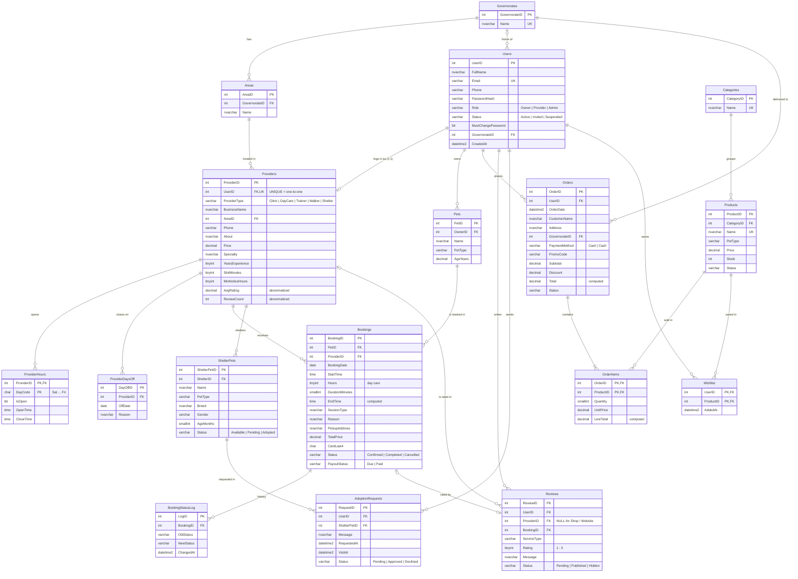
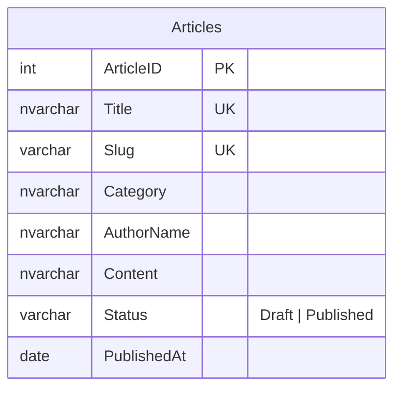

# mypet – ER diagram (MyPetDB)

Paste the code block below into https://mermaid.live to edit it or export PNG/SVG.
It also renders directly on GitHub, and in VS Code with the "Markdown Preview Mermaid Support" extension.
`ER-diagram.html` shows the same diagram in the browser, and `ER-diagram.png` is a ready image.

**How to read the lines (crow's foot):** `||` exactly one · `|o` zero or one · `|{` one or more · `o{` zero or more.
**Keys:** PK = primary key · FK = foreign key · UK = unique.

### Standalone table (no relations)

The blog table is not linked to any other table, so it is drawn on its own.

## Relationships

| Relation | Type | How it is built |
|---|---|---|
| Users – Providers | **one-to-one** | `Providers.UserID` is a FOREIGN KEY **and** UNIQUE |
| Governorates – Areas | one-to-many | `Areas.GovernorateID` |
| Areas – Providers | one-to-many | `Providers.AreaID` |
| Users – Pets | one-to-many | `Pets.OwnerID` |
| Pets – Bookings | one-to-many | `Bookings.PetID` |
| Providers – Bookings | one-to-many | `Bookings.ProviderID` |
| Providers – ProviderHours / ProviderDaysOff | one-to-many | `ProviderID` |
| Providers (shelters) – ShelterPets | one-to-many | `ShelterPets.ShelterID` |
| Bookings – BookingStatusLog | one-to-many | `BookingStatusLog.BookingID` (filled by a trigger) |
| Categories – Products | one-to-many | `Products.CategoryID` |
| Users – Orders | one-to-many | `Orders.UserID` |
| Users – Reviews, Providers – Reviews | one-to-many | `Reviews.UserID`, `Reviews.ProviderID` |
| Bookings – Reviews | one-to-one (optional) | filtered UNIQUE index on `Reviews.BookingID` |
| **Orders – Products** | **many-to-many** | junction table `OrderItems` (PK = OrderID + ProductID) |
| **Users – Products** | **many-to-many** | junction table `Wishlist` (PK = UserID + ProductID) |
| **Users – ShelterPets** | **many-to-many** | junction table `AdoptionRequests` (UNIQUE UserID + ShelterPetID) |
| Articles | standalone | no relations |
